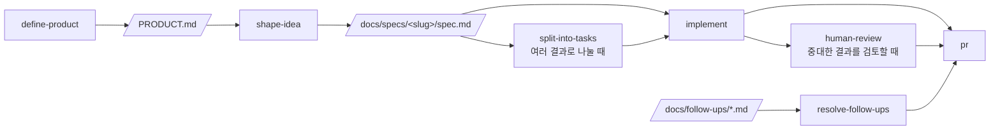

# MP3 정리

인터넷에서 받은 mp3 폴더를 고르면 곡을 찾아 파일 안의 제목 태그와 파일명을 `노래이름 - 가수이름`으로 통일하고, 빈 태그(앨범, 장르, 출시년도, 앨범아트, 가사)를 채워 지정한 폴더에 저장하는 웹서비스입니다.

- 음원 파일은 서버에 올라가지 않습니다. 브라우저가 폴더를 직접 읽고 씁니다. 서버는 곡 정보 검색(iTunes Search, MusicBrainz, LRCLIB) 요청만 대신 보냅니다.
- 원본 폴더의 파일은 바꾸지 않고, 결과는 사용자가 고른 저장 폴더에만 만듭니다.
- 폴더 접근 기능이 필요해 **Chrome, Edge 같은 Chromium 계열 브라우저**에서만 쓸 수 있습니다(Safari, Firefox 미지원).
- 제품 정의는 [PRODUCT.md](PRODUCT.md), 구현 범위는 [docs/specs/mp3-organizer/spec.md](docs/specs/mp3-organizer/spec.md)를 보세요.

> 이 저장소는 [Claude Hunt](https://www.claude-hunt.com) 강의용 Next.js 템플릿에서 시작했습니다. 템플릿의 워크플로우 문서는 [docs.claude-hunt.com](https://docs.claude-hunt.com)에 있습니다.

## 기술 스택

Next.js 16 (App Router) · React 19 · Tailwind CSS 4 · shadcn/ui · Bun · Vitest · Playwright

## 시작하기

```bash
bun install
bun dev
```

[http://localhost:3000](http://localhost:3000)에서 결과를 확인할 수 있습니다.

## 스크립트

| 명령어 | 설명 |
|---|---|
| `bun dev` | 개발 서버 실행 |
| `bun run build` | 프로덕션 빌드 |
| `bun start` | 프로덕션 서버 실행 |
| `bun run lint` | ESLint 실행 |
| `bun run typecheck` | `tsc --noEmit` 타입 검사 |
| `bun run test` | Vitest 단위/컴포넌트 테스트 1회 실행 |
| `bun run test:watch` | Vitest watch 모드 |
| `bun run test:e2e` | Playwright E2E 테스트 실행 |

## 배포

Next.js 앱이라 [Vercel](https://vercel.com)에 그대로 올릴 수 있습니다. 별도 설정 파일이 필요 없습니다.

1. Vercel에서 이 저장소를 가져옵니다(Import Project). 프레임워크는 Next.js로 자동 인식됩니다.
2. 빌드 명령은 기본값(`next build`)을 쓰고, 환경 변수는 필요 없습니다. 사용자에게 API 키를 요구하지 않는 서비스만 쓰기 때문입니다.
3. 배포 후 Chrome이나 Edge로 접속해 폴더를 골라 확인합니다.

다른 Node.js 호스팅에서는 `bun run build` 후 `bun start`로 실행합니다. 서버가 `itunes.apple.com`, `musicbrainz.org`, `lrclib.net`, `coverartarchive.org`에 접속할 수 있어야 합니다.

운영할 때 알아 둘 점입니다.

- 폴더 접근은 보안 컨텍스트가 필요해서 `https` 주소(또는 `localhost`)에서만 동작합니다. Vercel은 기본으로 `https`입니다.
- MusicBrainz는 초당 1건 요청 제한이 있습니다. 앱은 서버 인스턴스마다 요청 간격을 두지만, 사용자가 늘면 여러 인스턴스와 여러 사용자의 요청이 합쳐져 제한에 걸릴 수 있습니다. MusicBrainz는 iTunes에서 곡이 정해지지 않을 때만 부릅니다.
- 진행 상태와 처리하지 못한 목록은 사용자의 브라우저에만 저장됩니다. 서버에는 저장하지 않습니다.
- 빌드는 `next/font/google`로 Google Fonts를 받아 오므로 빌드 환경이 `fonts.googleapis.com`에 접속할 수 있어야 합니다.

## 테스트

- **단위·컴포넌트**: Vitest + Testing Library. 설정은 `vitest.config.mts`, 매처와 cleanup은 `vitest.setup.ts`에 있습니다. 테스트 파일은 소스 옆에 `*.test.ts(x)`로 둡니다(`app/page.test.tsx`, `lib/utils.test.ts` 참고). `globals`를 켜지 않았으므로 `describe`/`it`/`expect`는 `vitest`에서 import 합니다.
- **E2E**: Playwright. 설정은 `playwright.config.ts`, 테스트는 `e2e/*.spec.ts`에 둡니다. `webServer`가 `bun run dev`를 자동으로 띄우므로 별도 서버 실행이 필요 없습니다.

E2E를 처음 실행하기 전에 브라우저를 한 번 내려받아야 합니다.

```bash
bunx playwright install chromium
```

브라우저가 이미 설치된 환경(예: Claude Code 원격 세션)에서는 내려받는 대신 실행 파일 경로를 지정할 수 있습니다.

```bash
PLAYWRIGHT_CHROMIUM_PATH=/opt/pw-browsers/chromium bun run test:e2e
```

`async` Server Component는 Vitest가 아직 지원하지 않으므로 E2E로 검증합니다.

- **런타임 검증(에이전트용)**: [agent-browser](https://github.com/vercel-labs/agent-browser). 에이전트가 `next-dev-loop` 스킬로 실행 중인 앱을 직접 조작해 변경을 확인할 때 씁니다. 프로젝트 의존성이 아니므로 한 번 전역으로 설치합니다.

```bash
npm i -g agent-browser
agent-browser install  # 설치된 Chrome이 없을 때만
```

## Claude Code 워크플로우



파이프라인 밖에서는 `project-knowledge`, `maintain-project-context`, `add-stack-context`, `build-prototype`, `explain-visually`, `tdd`가 각자의 조건에 따라 켜집니다. `project-knowledge`는 `GLOSSARY.md`, `docs/decisions/`, `docs/follow-ups/`에 다음 작업에서도 재사용할 지식과 후속 항목을 남깁니다. Git 작업은 `commit`, `pull`, `push`, `pr`, `merge`가 해당 요청에 맞춰 처리합니다.
